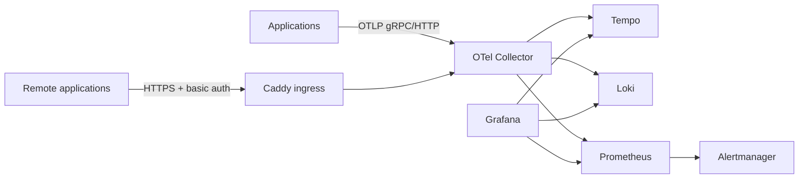

# Central Observability

Stack observability terpusat untuk aplikasi yang berjalan di Docker pada satu
host, dengan jalur OTLP yang aman untuk host remote. Aplikasi tidak perlu lagi
menjalankan Prometheus, Loki, Tempo, Grafana, atau Collector sendiri.

Komponen yang dikelola di repo ini:

- OpenTelemetry Collector sebagai satu-satunya gateway OTLP
- Grafana sebagai UI utama
- Prometheus untuk metrics dan aturan alert
- Loki untuk logs
- Tempo untuk traces
- Alertmanager untuk routing notifikasi

## Arsitektur



Ada dua batas jaringan:

- `monitoring` adalah network eksternal yang dipakai aplikasi. Aplikasi
  hanya dapat menjangkau Collector dengan nama `otel-collector`.
- `observability` adalah network internal milik stack. Tempo, Loki,
  Prometheus, Alertmanager, dan Grafana tidak dapat dijangkau langsung oleh
  container aplikasi.

Collector adalah satu-satunya container yang menjadi anggota kedua network.
Grafana, Prometheus, Loki, Tempo, dan Alertmanager hanya dipublikasikan ke
loopback host untuk administrasi.

## Versi image

Versi image dikunci di `compose.yaml`:

| Komponen | Versi |
|---|---|
| OpenTelemetry Collector Contrib | `0.164.0` |
| Grafana | `13.3.0` |
| Prometheus | `v3.15.1` |
| Loki | `3.6.16` |
| Tempo | `3.1.1` |
| Alertmanager | `v0.34.1` |
| Caddy, profil opsional | `2.11.7` |

Jangan mengganti tag dengan `latest`. Uji upgrade versi di host non-produksi
sebelum mengubah tag.

## Quick start

Prasyarat:

- Docker Engine dengan Compose v2
- DNS dan sertifikat TLS hanya diperlukan jika memakai profil `ingress`
- Waktu host tersinkron dengan NTP

Linux:

```sh
cp .env.example .env
sh scripts/init.sh
docker compose config --quiet
docker compose up -d
docker compose ps
```

Windows PowerShell:

```powershell
Copy-Item .env.example .env
powershell -ExecutionPolicy Bypass -File .\scripts\init.ps1
docker compose config --quiet
docker compose up -d
docker compose ps
```

Script init akan:

1. Membuat password acak Grafana di `secrets/grafana_admin_password`.
2. Membuat placeholder token Telegram bila belum ada.
3. Membuat `.env` dari contoh bila belum ada.
4. Membuat Docker network `monitoring` bila daemon Docker aktif.

Baca password Grafana tanpa menampilkannya di shell history:

```sh
cat secrets/grafana_admin_password
```

Di PowerShell:

```powershell
Get-Content secrets/grafana_admin_password
```

Grafana tersedia di http://127.0.0.1:3000 dengan user `admin`.

Endpoint dari host:

| Endpoint | URL |
|---|---|
| Grafana | http://127.0.0.1:3000 |
| Prometheus | http://127.0.0.1:9090 |
| Alertmanager | http://127.0.0.1:9093 |
| Loki | http://127.0.0.1:3100 |
| Tempo | http://127.0.0.1:3200 |
| Collector health | http://127.0.0.1:13133/ |
| OTLP gRPC untuk proses host | http://127.0.0.1:4317 |
| OTLP HTTP untuk proses host | http://127.0.0.1:4318 |
| Demo app, hanya profil `demo` | http://127.0.0.1:8080 |

Container aplikasi yang bergabung ke network `monitoring` memakai:

```text
http://otel-collector:4317
http://otel-collector:4318
```

## Demo dan verifikasi end-to-end

```sh
docker compose --profile demo up -d --build demo-app
sh scripts/e2e-smoke.sh
```

Windows:

```powershell
docker compose --profile demo up -d --build demo-app
powershell -ExecutionPolicy Bypass -File .\scripts\e2e-smoke.ps1
```

Demo menghasilkan:

- `go-demo` dengan environment `dev`
- histogram HTTP dengan explicit buckets
- trace untuk setiap request
- log OTLP untuk request normal dan error
- gauge heartbeat setiap 10 detik
- endpoint `/work`, `/error`, `/slow?delay_ms=700`, dan `/healthz`

Setelah uji otomatis lulus:

1. Buka http://127.0.0.1:3000/d/central-service-overview.
2. Pilih Service `go-demo` dan Environment `dev`.
3. Pastikan request rate, 5xx rate, dan p95/p99 memiliki data.
4. Buka panel log error, lalu klik `TraceID`. Trace harus terbuka di Tempo.
5. Buka panel slow traces dan pastikan request `/slow` tampil.

Di Linux, unit test alert rule dapat dijalankan dengan:

```sh
make test-rules
```

## Remote ingestion

Jangan membuka port Collector 4317 dan 4318 ke internet. Ada dua pilihan:

1. Rekomendasi: hubungkan server remote melalui WireGuard/Tailscale, lalu
   gunakan endpoint OTLP privat.
2. Jika harus publik, aktifkan profil Caddy:

```sh
docker compose --profile ingress up -d caddy
```

Isi `OTEL_DOMAIN`, `ACME_EMAIL`, `OTLP_BASIC_USER`, dan
`OTLP_BASIC_HASH` di `.env`. Buat hash dengan:

```sh
docker run --rm -it caddy:2.11.7 caddy hash-password
```

Nilai bcrypt di `.env` harus dibungkus single quote agar karakter `$` tidak
diinterpolasi oleh Compose.

Aplikasi remote menggunakan endpoint HTTPS dan header Basic auth. Detail
variabel dan contohnya ada di [INTEGRATION.md](INTEGRATION.md). Basic auth
melindungi akses jaringan, tetapi tidak memisahkan data antar penyewa: setiap
aplikasi yang terautentikasi masih dapat mengirim label `service.name` palsu.
Untuk zona kepercayaan yang berbeda, gunakan endpoint/gateway terpisah.

## Alert dan notifikasi

Alert awal tersedia di
[config/prometheus/rules/observability-alerts.yml](config/prometheus/rules/observability-alerts.yml):

- HTTP 5xx rate di atas 5% selama 10 menit
- p95 latency di atas 500 ms selama 10 menit
- tidak ada heartbeat aplikasi
- Collector tidak dapat di-scrape
- Watchdog internal untuk memastikan Prometheus dapat mengirim alert ke
  Alertmanager tanpa membanjiri Telegram

Ganti placeholder di:

- `secrets/telegram_bot_token`
- `secrets/telegram_chat_id`

lalu jalankan:

```sh
docker compose restart alertmanager
```

Contoh receiver Slack dan email dapat ditambahkan langsung ke
`config/alertmanager/alertmanager.yml`. Utamakan `*_file` untuk kredensial.

## Operasi

- Reload konfigurasi Prometheus setelah mengubah rule:

```sh
docker compose kill -s SIGHUP prometheus
```

- Melihat log:

```sh
docker compose logs -f --tail=200 otel-collector prometheus loki tempo grafana
```

- Menghentikan stack tanpa menghapus volume:

```sh
docker compose down
```

- Backup cold dan konsisten:

```sh
sh scripts/backup.sh
```

Di Windows:

```powershell
powershell -ExecutionPolicy Bypass -File .\scripts\backup.ps1
```

Retensi, kapasitas, keamanan, backup, dan batasan diuraikan di
[OPERATIONS.md](OPERATIONS.md). Kontrak onboarding aplikasi ada di
[INTEGRATION.md](INTEGRATION.md).

## Layout repository

```text
compose.yaml
config/otel-collector/       pipeline OTLP
config/prometheus/          scrape, OTLP metrics, rules
config/loki/                OTLP logs, retention, index labels
config/tempo/               OTLP traces, retention
config/alertmanager/        routing dan receiver
grafana/provisioning/       datasource dan dashboard provider
grafana/dashboards/         JSON dashboard
ingress/                    TLS dan auth untuk remote OTLP
examples/go-demo-app/       aplikasi uji end-to-end
scripts/                    init, backup, smoke test
```

