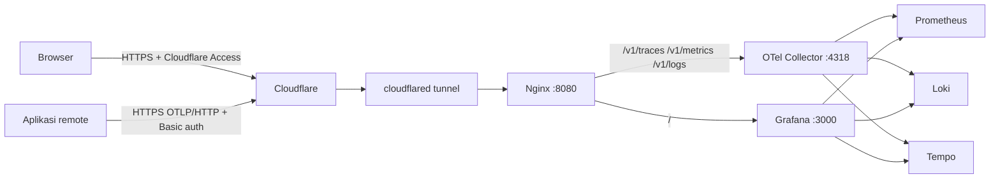

# Akses Online Observability

Dokumen ini menjelaskan cara membuat stack pusat dapat diakses dari internet
tanpa membuka port backend ke publik. Arsitektur yang dipakai mengikuti Nginx
dan Cloudflare Tunnel yang sudah berjalan di VPS.



Tidak ada port `80`, `443`, `3000`, `9090`, `9093`, `3100`, `3200`,
`4317`, atau `4318` yang perlu dipublikasikan ke internet. Cloudflare Tunnel
adalah satu-satunya jalur masuk.

## Hostname

| Hostname | Fungsi | Akses |
|---|---|---|
| `observability.madgo.my.id` | Grafana UI | Cloudflare Access + login Grafana |
| `otlp.madgo.my.id` | OTLP/HTTP untuk aplikasi remote | Basic auth per aplikasi, opsional Cloudflare Access Service Auth |

Prometheus, Loki, Tempo, dan Alertmanager tidak memiliki hostname publik.
Gunakan SSH tunnel atau Tailscale untuk akses admin.

Nama di atas dapat diganti. Jika diganti, ubah `server_name` di
[observability.conf](../deploy/nginx/observability.conf), `GRAFANA_ROOT_URL`
di `.env`, dan Public Hostname di Cloudflare Tunnel.

## Status deployment saat ini

- Stack berjalan di `/home/ahmadkusumahdev/central-observability` dengan Nginx
  VPS sebagai edge Cloudflare Tunnel.
- Grafana sudah dapat dibuka di `https://observability.madgo.my.id`.
- OTLP/HTTP sudah aktif di `https://otlp.madgo.my.id` dengan Basic auth per
  aplikasi. Request tanpa kredensial ditolak 401.
- Cloudflare Access untuk Grafana belum diaktifkan. Tambahkan Access policy
  sebelum membagikan URL ini ke pengguna lain.
- Secret Telegram masih placeholder; isi dua file di `secrets/` agar
  Alertmanager dapat mengirim notifikasi.

## Deploy stack di VPS

Target direktori:

```text
/home/ahmadkusumahdev/central-observability
```

Pada VPS ini user `ahmadkusumahdev` tidak berada di grup `docker`; perintah
Docker di bawah dijalankan dengan `sudo`. Jangan menambahkan user ke grup
`docker` tanpa audit karena akses grup itu setara akses root.

Langkah awal:

```sh
cd /home/ahmadkusumahdev/central-observability
sh scripts/init.sh
cp deploy/.env.production.example .env
```

Setelah `init.sh`, isi `.env` dengan nilai produksi dan isi secret yang
diperlukan. File `.env` dan `secrets/` sudah diabaikan Git.

File secret yang dibaca container non-root harus dapat dibaca user container.
Pada deployment ini file memakai `0644` karena host hanya dipakai satu user;
jika memakai group khusus, gunakan `0640` dengan GID container yang sesuai.
Tanpa permission baca, Grafana akan menolak login admin dan Alertmanager tidak
dapat membaca token Telegram.

Buat network yang dipakai stack:

```sh
sudo docker network create monitoring 2>/dev/null || true
sudo docker network create observability-ingress 2>/dev/null || true
```

Jalankan stack dengan overlay produksi:

```sh
sudo docker compose -f compose.yaml -f deploy/compose.prod.yml up -d
sudo docker compose -f compose.yaml -f deploy/compose.prod.yml ps
```

Periksa kesehatan dasar:

```sh
curl -fsS http://127.0.0.1:13133/
curl -fsS http://127.0.0.1:9090/-/ready
curl -fsS http://127.0.0.1:3100/ready
curl -fsS http://127.0.0.1:3200/ready
```

## Pasang Nginx ingress

Salin [observability.conf](../deploy/nginx/observability.conf) ke
`/home/ahmadkusumahdev/nginx/observability.conf`, lalu tambahkan volume dan
network ke service `nginx` seperti dijelaskan di
[deploy/nginx/README.md](../deploy/nginx/README.md).

Buat minimal satu kredensial OTLP:

```sh
cd /home/ahmadkusumahdev/nginx
sh add-otlp-client.sh example-go-service
```

Script mencetak password dan nilai `OTEL_EXPORTER_OTLP_HEADERS`. Simpan
password di secret manager; jangan menaruhnya di repository.

Validasi dan reload:

```sh
docker exec nginx-proxy nginx -t
docker exec nginx-proxy nginx -s reload
```

## Cloudflare Tunnel dan Access

Tunnel yang sedang berjalan memakai token dan ingress dikelola dari dashboard.
File `cloudflared-config.yml` di folder Nginx bukan sumber konfigurasi aktif.

Di Cloudflare Zero Trust, tambahkan Public Hostname:

| Public hostname | Service |
|---|---|
| `observability.madgo.my.id` | `http://nginx-proxy:8080` |
| `otlp.madgo.my.id` | `http://nginx-proxy:8080` |

Lalu buat Access application:

1. `observability.madgo.my.id`: policy **Allow** berdasarkan email atau
   identity provider. Aktifkan MFA di identity provider.
2. `otlp.madgo.my.id`: policy **Service Auth**. Buat service token per
   aplikasi/environment.
3. Jangan membuat Access application wildcard `*.madgo.my.id`.
4. Jangan mengaktifkan gRPC pada hostname OTLP. Gunakan OTLP/HTTP.

Pengaturan Cloudflare lain:

- SSL/TLS mode **Full (strict)** untuk record A/AAAA yang diproksikan. Untuk
  Tunnel, TLS publik berhenti di Cloudflare dan origin tidak membuka 443.
- **Always Use HTTPS** aktif. Redirect 301/302 dapat mengubah POST menjadi GET;
  gunakan 308 bila membuat redirect sendiri.
- Cache Rule **Bypass** untuk `observability.madgo.my.id/*` dan
  `otlp.madgo.my.id/*`.
- Nonaktifkan Rocket Loader dan Auto Minify untuk Grafana.
- Jangan mengaktifkan Bot Fight Mode pada zona yang menerima OTLP; SDK dapat
  ditantang dan telemetry hilang.
- Untuk Grafana, rate limit `POST /login` di Cloudflare atau Nginx.

Cloudflare Access tidak mendukung gRPC. Ini alasan endpoint publik memakai
OTLP/HTTP; gRPC tetap dipakai aplikasi same-host melalui network Docker.

## Env aplikasi remote

Setelah kredensial OTLP dibuat dan hostname aktif, aplikasi remote memakai:

```dotenv
OTEL_EXPORTER_OTLP_ENDPOINT=https://otlp.madgo.my.id
OTEL_EXPORTER_OTLP_PROTOCOL=http/protobuf
OTEL_EXPORTER_OTLP_HEADERS=Authorization=Basic%20BASE64_URLENCODED
OTEL_EXPORTER_OTLP_TIMEOUT=10000
OTEL_EXPORTER_OTLP_COMPRESSION=gzip
OTEL_SERVICE_NAME=nama-service
OTEL_RESOURCE_ATTRIBUTES=deployment.environment.name=prod,service.namespace=acme,service.version=1.0.0
```

`BASE64_URLENCODED` adalah hasil base64 dari `user:password`, lalu di-URL-encode.
Script `add-otlp-client.sh` mencetak nilai yang sudah siap.

Jika Cloudflare Access Service Auth diaktifkan, tambahkan dua header ke nilai
`OTEL_EXPORTER_OTLP_HEADERS`, dipisahkan koma:

```dotenv
OTEL_EXPORTER_OTLP_HEADERS=Authorization=Basic%20...,CF-Access-Client-Id=...,CF-Access-Client-Secret=...
```

Nilai header harus URL-encoded sesuai spesifikasi OTLP. Jangan menaruh token di
URL, query string, nama image, atau log.

Untuk aplikasi yang berjalan di Docker pada host yang sama, gunakan jalur
privat:

```dotenv
OTEL_EXPORTER_OTLP_ENDPOINT=http://otel-collector:4317
OTEL_EXPORTER_OTLP_PROTOCOL=grpc
```

## Verifikasi

Dari host VPS:

```sh
curl -fsS http://127.0.0.1:3000/api/health
curl -fsS http://127.0.0.1:13133/
```

Dari dalam container Nginx, uji Host header sebelum DNS Cloudflare aktif:

```sh
docker exec nginx-proxy wget -qO- --header='Host: observability.madgo.my.id' http://127.0.0.1:8080/healthz
docker exec nginx-proxy wget -qO- --header='Host: otlp.madgo.my.id' http://127.0.0.1:8080/healthz
```

Uji OTLP tanpa kredensial harus `401`. Uji dengan kredensial yang dibuat
script harus diteruskan ke Collector. Dari luar, setelah DNS aktif:

```sh
curl -i https://observability.madgo.my.id/healthz
curl -i https://otlp.madgo.my.id/healthz
curl -i -X POST https://otlp.madgo.my.id/v1/traces
```

Request OTLP tanpa Basic auth harus `401`; request dengan Basic auth yang salah
juga `401`. Jika mendapat `302` ke halaman login Access, konfigurasi Service
Auth belum benar.

## Batasan dan risiko

- Satu VPS tetap single point of failure. Backup volume belum otomatis
  off-site; lihat [OPERATIONS.md](OPERATIONS.md).
- Cloudflare Tunnel memakai koneksi keluar. Jangan membuka port 80/443 ke host;
  origin hanya boleh dijangkau cloudflared.
- Cloudflare Access tidak melindungi gRPC. Jangan membuat hostname gRPC publik
  kecuali benar-benar diperlukan.
- Cloudflare default 524 sekitar 125 detik. Query Grafana yang sangat panjang
  tetap dapat terpotong; Nginx memakai `proxy_read_timeout 110s` agar 504
  tercatat lebih dulu.
- Body OTLP publik dibatasi 8 MiB di Nginx. Collector membatasi 16 MiB. Jika
  payload sering 413, perkecil batch sebelum menaikkan limit.
- Basic auth adalah kredensial statis. Rotasi berkala dan gunakan satu user per
  aplikasi. Untuk keamanan lebih tinggi, gunakan Cloudflare Access Service Auth
  atau OIDC/mTLS di Collector.
- Jangan menyalin `.env`, `secrets/`, `nginx/secrets/otlp.htpasswd`, atau file
  kredensial client ke Git. Repository ini bisa dipush tanpa nilai produksi;
  VPS menyimpan nilai sebenarnya secara lokal.

Dokumentasi terkait:

- [AGENT-INTEGRATION.md](AGENT-INTEGRATION.md)
- [INTEGRATION.md](INTEGRATION.md)
- [TROUBLESHOOTING.md](TROUBLESHOOTING.md)
- [OPERATIONS.md](OPERATIONS.md)
- [deploy/nginx/README.md](../deploy/nginx/README.md)
