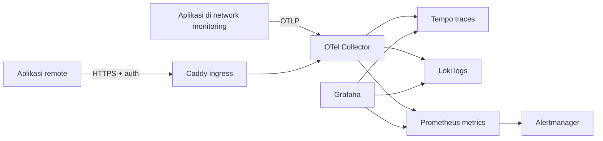

# Dokumentasi Observability Terpusat

Stack ini adalah pintu masuk telemetry untuk semua aplikasi: traces, metrics,
dan logs dikirim lewat satu endpoint OTLP, lalu dirutekan ke Tempo,
Prometheus, dan Loki. Grafana membaca ketiganya dan menghubungkan trace, log,
dan exemplar.

## Alur data



Collector adalah satu-satunya service yang menjadi anggota network aplikasi
dan network backend. Tempo, Loki, Prometheus, Alertmanager, dan Grafana tidak
terbuka untuk aplikasi.

## Service dan alamat

| Service | Alamat dari aplikasi Docker | Alamat dari host |
|---|---|---|
| Collector OTLP gRPC | `otel-collector:4317` | `http://127.0.0.1:4317` |
| Collector OTLP HTTP | `otel-collector:4318` | `http://127.0.0.1:4318` |
| Collector health | `http://otel-collector:13133/` | `http://127.0.0.1:13133/` |
| Grafana | Tidak untuk aplikasi | `http://127.0.0.1:3000` |
| Prometheus | Tidak untuk aplikasi | `http://127.0.0.1:9090` |
| Loki | Tidak untuk aplikasi | `http://127.0.0.1:3100` |
| Tempo | Tidak untuk aplikasi | `http://127.0.0.1:3200` |
| Alertmanager | Tidak untuk aplikasi | `http://127.0.0.1:9093` |

Untuk server remote, gunakan Tailscale/WireGuard atau aktifkan profil Caddy
sesuai [INTEGRATION.md](INTEGRATION.md).

## Mulai dari mana

1. [INTEGRATION.md](INTEGRATION.md): langkah lengkap menghubungkan aplikasi
   baru dalam tujuh tahap.
2. [NAMING.md](NAMING.md): aturan nama service, environment, dan label.
3. [TROUBLESHOOTING.md](TROUBLESHOOTING.md): pemeriksaan saat data tidak masuk.
4. [OPERATIONS.md](OPERATIONS.md): retensi, kapasitas, backup, upgrade, dan
   alert.
5. [ROADMAP.md](ROADMAP.md): batasan dan rencana berikutnya.
6. [adr/README.md](adr/README.md): alasan keputusan arsitektur.

## Kontrak minimum aplikasi

```dotenv
OTEL_EXPORTER_OTLP_ENDPOINT=http://otel-collector:4317
OTEL_EXPORTER_OTLP_PROTOCOL=grpc
OTEL_SERVICE_NAME=chat-api
OTEL_RESOURCE_ATTRIBUTES=deployment.environment.name=prod,service.namespace=acme,service.version=1.4.2
OTEL_TRACES_EXPORTER=otlp
OTEL_METRICS_EXPORTER=otlp
OTEL_LOGS_EXPORTER=otlp
```

Network yang harus dipakai aplikasi:

```yaml
networks:
  monitoring:
    external: true
    name: monitoring
```

## Dokumentasi resmi

- [OpenTelemetry Collector](https://opentelemetry.io/docs/collector/)
- [OpenTelemetry Protocol](https://opentelemetry.io/docs/specs/otlp/)
- [Prometheus dan OpenTelemetry](https://prometheus.io/docs/guides/opentelemetry/)
- [Loki OTLP ingestion](https://grafana.com/docs/loki/latest/send-data/otel/)
- [Grafana Tempo](https://grafana.com/docs/tempo/latest/)
- [Grafana provisioning](https://grafana.com/docs/grafana/latest/administration/provisioning/)

