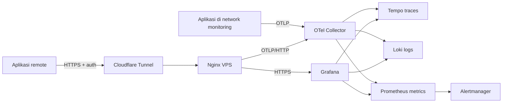

# Dokumentasi Observability Terpusat

Stack ini adalah pintu masuk telemetry untuk semua aplikasi: traces, metrics,
dan logs dikirim lewat satu endpoint OTLP, lalu dirutekan ke Tempo,
Prometheus, dan Loki. Grafana membaca ketiganya dan menghubungkan trace, log,
dan exemplar.

## Alur data



Collector adalah satu-satunya service yang menjadi anggota network aplikasi
dan network backend. Tempo, Loki, Prometheus, Alertmanager, dan Grafana tidak
terbuka untuk aplikasi.

## Service dan alamat

| Service | Alamat dari aplikasi Docker | Alamat dari host |
|---|---|---|
| Collector OTLP gRPC | `otel-collector:4317` | `http://127.0.0.1:4317` |
| Collector OTLP HTTP | `otel-collector:4318` | `http://127.0.0.1:4318` |
| Collector health | `http://otel-collector:13133/` | `http://127.0.0.1:13133/` |
| Grafana | Tidak untuk aplikasi | `http://127.0.0.1:3000` |
| Prometheus | Tidak untuk aplikasi | `http://127.0.0.1:9090` |
| Loki | Tidak untuk aplikasi | `http://127.0.0.1:3100` |
| Tempo | Tidak untuk aplikasi | `http://127.0.0.1:3200` |
| Alertmanager | Tidak untuk aplikasi | `http://127.0.0.1:9093` |
| Grafana remote | Tidak untuk aplikasi | `https://observability.madgo.my.id` |
| OTLP/HTTP remote | `https://otlp.madgo.my.id` | `https://otlp.madgo.my.id` |

Untuk server remote, gunakan Cloudflare Tunnel + Nginx sesuai
[ONLINE-ACCESS.md](ONLINE-ACCESS.md). Tailscale/WireGuard tetap pilihan yang
lebih kuat untuk akses admin dan gRPC privat.

## Mulai dari mana

Jalur tercepat:

1. Salin [examples/.env.example](../examples/.env.example) menjadi
   `otel.env`.
2. Ganti `OTEL_SERVICE_NAME` dan
   `deployment.environment.name`.
3. Tambahkan external network dari potongan Compose di
   [examples/docker-compose.client.yml](../examples/docker-compose.client.yml).
4. Jalankan aplikasi dan ikuti checklist di [INTEGRATION.md](INTEGRATION.md).

Jika Anda memberikan tugas integrasi kepada coding agent, berikan
[AGENT-INTEGRATION.md](AGENT-INTEGRATION.md). Dokumen itu memuat package Go
yang harus disalin, langkah untuk project baru, dan langkah migrasi untuk
project yang sudah memakai `go-chat/pkg/observability`.

Dokumen lengkap:

1. [INTEGRATION.md](INTEGRATION.md): langkah lengkap menghubungkan aplikasi
   baru dalam tujuh tahap.
2. [AGENT-INTEGRATION.md](AGENT-INTEGRATION.md): instruksi siap diberikan ke
   coding agent, termasuk template Go dan migrasi package lama.
3. [NAMING.md](NAMING.md): aturan nama service, environment, dan label.
4. [TROUBLESHOOTING.md](TROUBLESHOOTING.md): pemeriksaan saat data tidak masuk.
5. [OPERATIONS.md](OPERATIONS.md): retensi, kapasitas, backup, upgrade, dan
   alert.
6. [ROADMAP.md](ROADMAP.md): batasan dan rencana berikutnya.
7. [adr/README.md](adr/README.md): alasan keputusan arsitektur.
8. [AGENTS.md](../AGENTS.md): kontrak kerja untuk coding agent.
9. [ONLINE-ACCESS.md](ONLINE-ACCESS.md): akses publik, Nginx, Cloudflare
   Tunnel, dan keamanan endpoint remote.

Hasil uji template dan smoke test terakhir ada di
[VERIFICATION.md](VERIFICATION.md).

## Kontrak minimum aplikasi

```dotenv
OTEL_EXPORTER_OTLP_ENDPOINT=http://otel-collector:4317
OTEL_EXPORTER_OTLP_PROTOCOL=grpc
OTEL_SERVICE_NAME=chat-api
OTEL_RESOURCE_ATTRIBUTES=deployment.environment.name=prod,service.namespace=acme,service.version=1.4.2
OTEL_TRACES_EXPORTER=otlp
OTEL_METRICS_EXPORTER=otlp
OTEL_LOGS_EXPORTER=otlp
```

Network yang harus dipakai aplikasi:

```yaml
networks:
  monitoring:
    external: true
    name: monitoring
```

## Contoh dan pengujian

Folder [examples](../examples/) berisi aplikasi Go, Node.js, dan Python yang
masing-masing menghasilkan traces, histogram, logs, heartbeat, HTTP client
span, dan SQLite database span.

Folder `templates/` berisi template per bahasa yang dapat disalin ke project
baru. Setiap template memakai OTLP untuk ketiga sinyal dan tidak menjalankan
stack monitoring sendiri.

| Bahasa | Template | Prompt untuk agent |
|---|---|---|
| Go | [templates/go-service](../templates/go-service/README.md) | [templates/APP-AGENT-PROMPT.md](../templates/APP-AGENT-PROMPT.md) |
| Node.js | [templates/node](../templates/node/README.md) | [templates/node/APP-AGENT-PROMPT.md](../templates/node/APP-AGENT-PROMPT.md) |
| PHP | [templates/php](../templates/php/README.md) | [templates/php/APP-AGENT-PROMPT.md](../templates/php/APP-AGENT-PROMPT.md) |
| Rust | [templates/rust](../templates/rust/README.md) | [templates/rust/APP-AGENT-PROMPT.md](../templates/rust/APP-AGENT-PROMPT.md) |

```sh
docker compose -f examples/docker-compose.client.yml --profile go up -d --build
docker compose -f examples/docker-compose.client.yml --profile node up -d --build
docker compose -f examples/docker-compose.client.yml --profile python up -d --build
```

Untuk memeriksa jalur collector tanpa aplikasi:

```sh
sh scripts/smoke-test.sh
```

Service uji yang dikirim bernama `smoke-test` pada environment
`dev`. Script menunggu metrics di Prometheus, logs di Loki, dan traces
di Tempo, lalu mencetak PASS atau gagal dengan exit code bukan nol.

## Dokumentasi resmi

- [OpenTelemetry Collector](https://opentelemetry.io/docs/collector/)
- [OpenTelemetry Protocol](https://opentelemetry.io/docs/specs/otlp/)
- [Prometheus dan OpenTelemetry](https://prometheus.io/docs/guides/opentelemetry/)
- [Loki OTLP ingestion](https://grafana.com/docs/loki/latest/send-data/otel/)
- [Grafana Tempo](https://grafana.com/docs/tempo/latest/)
- [Grafana provisioning](https://grafana.com/docs/grafana/latest/administration/provisioning/)

